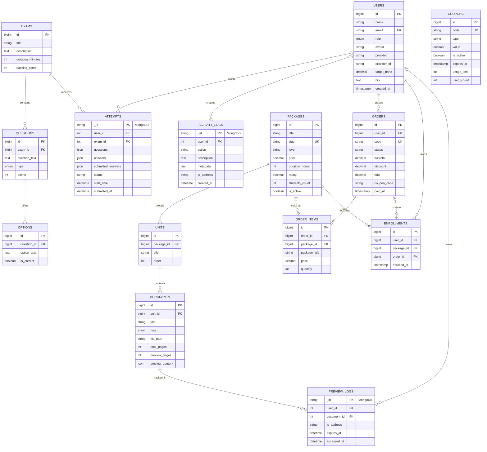

# ExamPlatform — ERD

Sơ đồ dưới đây phản ánh schema hiện tại trong các migration Laravel. Các bảng
nghiệp vụ dùng MySQL; `attempts`, `activity_logs` và `preview_logs` được model
chạy trên MongoDB khi `MONGODB_ENABLED=true` (khi tắt Mongo, chúng fallback về
connection mặc định để test).

`COUPONS` không có khóa ngoại trực tiếp: `orders.coupon_code` lưu snapshot mã
được áp dụng tại thời điểm checkout. `ATTEMPTS` và `PREVIEW_LOGS` giữ ID của
thực thể MySQL để liên kết chéo giữa hai database; các liên kết này được kiểm
tra ở tầng service/controller thay vì bằng foreign key vật lý.

